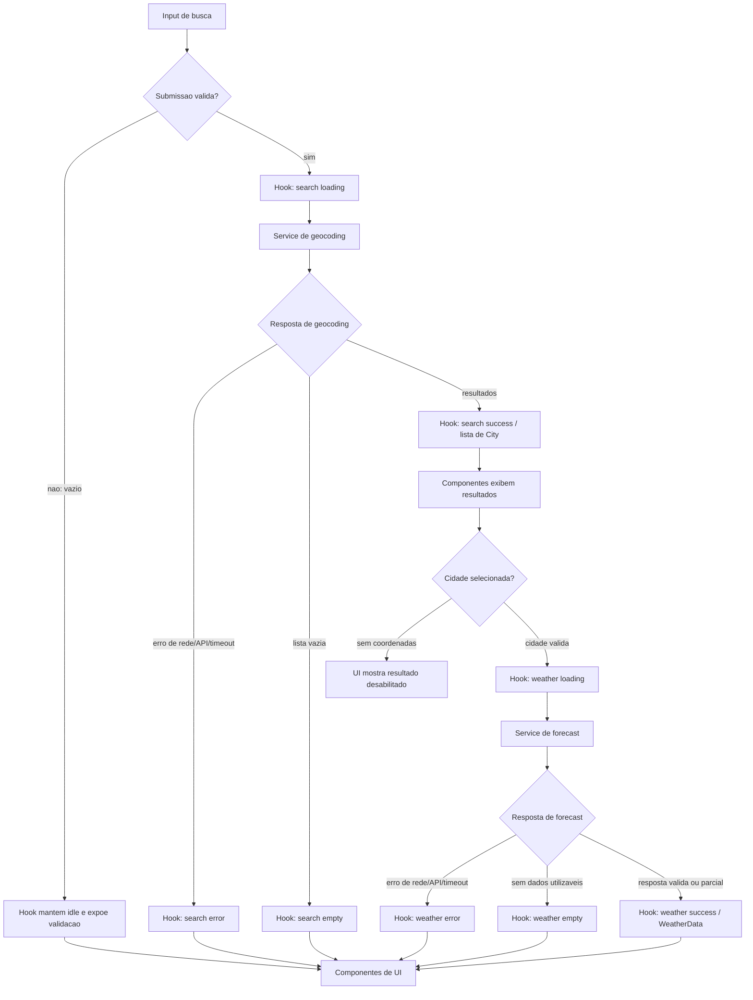

# Weather App — Technical Plan

## Architecture

Aplicação web client-side, sem backend próprio, dividida em quatro camadas com dependências unidirecionais:

- **components — apresentação:** renderizam props, estados visuais e ações. Não fazem HTTP nem convertem payloads externos.
- **hooks — orquestração/estado:** mantêm consulta, resultados, localidade selecionada, dados meteorológicos e unidade; coordenam ações, retry e descarte de respostas antigas.
- **services — acesso a dados:** montam URLs, executam `fetch`, aplicam timeout e traduzem falhas HTTP/rede. Não mantêm estado React nem formatam valores para a tela.
- **lib — funções puras:** validam/mapeiam respostas para tipos de domínio, convertem unidades, formatam valores e traduzem códigos WMO. Não acessam rede, relógio global nem React; dependem apenas de argumentos.

Fluxo de dependências: `components -> hooks -> services -> Open-Meteo`; services e hooks podem chamar funções de `lib`, enquanto `lib` não depende das outras camadas. `App.tsx` compõe componentes e conecta-os ao hook; `main.tsx` apenas inicializa a aplicação.

```text
Pessoa usuária -> components -> hooks -> services -> Open-Meteo
                                   |         |
                                   +-------> lib (mapeamento e funções puras)
```

Essa divisão isola mudanças de apresentação, estado, protocolo externo e regras determinísticas. Ela permite testar components com props e callbacks, hooks com services mockados, services com `fetch` controlado e `lib` com entradas/saídas puras, sem servidor ou rede real.

Fluxo principal: buscar cidade -> selecionar resultado explicitamente -> consultar clima atual e cinco dias -> alternar unidade na apresentação. Requisitos relacionados: FR-01 a FR-06.

## Tech Stack

| Área | Decisão | Justificativa |
| --- | --- | --- |
| Linguagem e build | TypeScript strict, React 19, Vite 8 | Já declarados no projeto; tipagem ajuda a validar respostas externas e estados. |
| UI | React e Tailwind CSS | Stack definida nas instruções do projeto; não introduzir biblioteca de componentes neste escopo. |
| Acesso a dados | `fetch` nativo encapsulado em serviço | Duas chamadas HTTP, sem necessidade de cliente de dados adicional. |
| Testes unitários/componentes | Vitest, Testing Library, user-event, jsdom | Dependências já disponíveis; cobre lógica e interação acessível. |
| Testes de navegador | Playwright | Já configurado no projeto para fluxos E2E e viewports. |
| Qualidade | Biome | Lint e formatação definidos pelo repositório. |

## Project Structure

Estrutura inicial recomendada; cada pasta corresponde a uma responsabilidade e não a uma camada adicional de abstração.

```text
src/
  App.tsx
  main.tsx
  components/
    CitySearch.tsx
    CityResults.tsx
    CurrentWeather.tsx
    DailyForecast.tsx
    TemperatureUnitControl.tsx
    RequestStatus.tsx
  hooks/
    useWeatherApp.ts
  services/
    openMeteoService.ts
  lib/
    mapGeocodingResponse.ts
    mapForecastResponse.ts
    temperature.ts
    formatters.ts
    weatherCodes.ts
  types/
    weather.ts
tests/
  components/
  hooks/
  services/
  lib/
  e2e/
```

`openMeteoService` é dono de URL, parâmetros, transporte, timeout e classificação de erro. Mapeadores em `lib` recebem dados desconhecidos e retornam tipos do domínio ou erro de validação; não mantêm estado. Componentes recebem valores já normalizados e callbacks. Fixtures controladas são compartilhadas pelos testes de service, hook e E2E; funções de `lib` usam testes unitários puros.

## Data Model

Contratos de domínio, não payloads crus do provedor. Campos meteorológicos marcados como baseline só entram no contrato após aprovação de OQ-02.

```ts
type Unit = "celsius" | "fahrenheit";

interface City {
  id?: number; // Open-Meteo geocoding result ID.
  name: string; // City name returned by geocoding.
  region?: string; // First-level administrative region, when available.
  country?: string; // Country display name.
  countryCode?: string; // ISO country code, when returned.
  latitude?: number; // Latitude; required before requesting weather.
  longitude?: number; // Longitude; required before requesting weather.
  timezone?: string; // IANA timezone, when returned by geocoding.
}

interface CurrentWeather {
  time: string; // Observation time returned in the forecast timezone.
  temperatureC?: number; // Open-Meteo temperature_2m, requested in Celsius.
  apparentTemperatureC?: number; // Open-Meteo apparent_temperature, in Celsius.
  humidityPercent?: number; // Open-Meteo relative_humidity_2m, from 0 to 100.
  windSpeedKmh?: number; // Open-Meteo wind_speed_10m, requested in km/h.
  weatherCode?: number; // WMO code from Open-Meteo weather_code.
}

interface ForecastDay {
  date: string; // Local calendar date in YYYY-MM-DD format.
  minTemperatureC?: number; // Open-Meteo temperature_2m_min, in Celsius.
  maxTemperatureC?: number; // Open-Meteo temperature_2m_max, in Celsius.
  precipitationProbabilityPercent?: number; // Open-Meteo precipitation_probability_max, 0 to 100.
  weatherCode?: number; // WMO code from Open-Meteo daily weather_code.
}

interface WeatherData {
  city: City; // Selected city used for this response.
  timezone: string; // IANA timezone returned by the forecast endpoint.
  current?: CurrentWeather; // Current conditions; absent if unavailable.
  forecastDays: ForecastDay[]; // Available daily rows, up to five.
  fetchedAt: string; // Client fetch completion time as an ISO timestamp.
}
```

Todos os campos derivados de medições são opcionais para representar respostas parciais. `weatherCode` preserva o código WMO recebido; a UI usa uma tabela local de rótulos pt-BR com fallback “Condição indisponível” para códigos desconhecidos. Resultados `City` sem latitude ou longitude são exibidos desabilitados com explicação; ambos são obrigatórios antes de consultar o clima. Temperaturas são mantidas em Celsius no domínio e convertidas apenas para apresentação usando `Unit`.

## Data Flow

1. Submissão por Enter ou botão: remover espaços externos; vazio produz validação local e zero chamadas.
2. Serviço envia a busca ao geocoding; mapper transforma cada resultado em `City` e a UI desabilita resultados sem latitude ou longitude.
3. UI lista resultados sem seleção automática. Seleção explícita de um resultado válido cancela/ignora consultas meteorológicas anteriores; resultados sem coordenadas permanecem desabilitados e explicados.
4. Serviço solicita clima atual e dias usando coordenadas da cidade; respostas são validadas e mapeadas para `WeatherData`.
5. Hook publica sucesso, vazio ou erro. Apenas a resposta da interação mais recente pode atualizar a UI.
6. Alternância de unidade atualiza estado de apresentação; não refaz a consulta nem modifica cidade ou datas.



## External APIs

Sem API key, conforme a decisão do discovery. O serviço envia parâmetros URL-encoded e trata o JSON recebido como `unknown` até validação; os exemplos abaixo são resumidos, não fixtures normativas.

### Geocoding

- **URL:** `https://geocoding-api.open-meteo.com/v1/search`
- **Parâmetros:** `name` (consulta após trim); `count=10` (limite de resultados proposto); `language=pt` (rótulos de localização, sujeito à cobertura); `format=json`.

Exemplo resumido de resposta:

```json
{
  "results": [
    {
      "id": 2950159,
      "name": "Berlin",
      "latitude": 52.52437,
      "longitude": 13.41053,
      "timezone": "Europe/Berlin",
      "country_code": "DE",
      "country": "Germany",
      "admin1": "Berlin"
    }
  ]
}
```

Quando `results` estiver ausente ou vazio, tratar como busca sem resultados. Mapear `id` → `City.id`, `name` → `City.name`, `admin1` → `City.region`, `country` → `City.country`, `country_code` → `City.countryCode`, `latitude`/`longitude` para as coordenadas e `timezone` → `City.timezone`. Coordenadas ausentes tornam o resultado não selecionável.

### Forecast: clima atual e cinco dias

- **URL:** `https://api.open-meteo.com/v1/forecast`
- **Parâmetros obrigatórios:** `latitude` e `longitude` da cidade selecionada.
- **`current`:** `temperature_2m,apparent_temperature,relative_humidity_2m,weather_code,wind_speed_10m`.
- **`daily`:** `temperature_2m_min,temperature_2m_max,weather_code,precipitation_probability_max`.
- **Período/fuso/unidades:** `forecast_days=5`, `timezone=auto`, `temperature_unit=celsius`, `wind_speed_unit=kmh`.

Exemplo resumido de resposta (cinco valores diários; valores apenas ilustrativos):

```json
{
  "latitude": 52.52,
  "longitude": 13.42,
  "timezone": "Europe/Berlin",
  "current_units": {
    "time": "iso8601",
    "temperature_2m": "°C",
    "apparent_temperature": "°C",
    "relative_humidity_2m": "%",
    "weather_code": "wmo code",
    "wind_speed_10m": "km/h"
  },
  "current": {
    "time": "2026-11-11T12:15",
    "temperature_2m": 8.4,
    "apparent_temperature": 6.9,
    "relative_humidity_2m": 72,
    "weather_code": 3,
    "wind_speed_10m": 11.2
  },
  "daily_units": {
    "time": "iso8601",
    "temperature_2m_min": "°C",
    "temperature_2m_max": "°C",
    "weather_code": "wmo code",
    "precipitation_probability_max": "%"
  },
  "daily": {
    "time": ["2026-11-11", "2026-11-12", "2026-11-13", "2026-11-14", "2026-11-15"],
    "temperature_2m_min": [5.1, 4.8, 3.9, 4.2, 5.0],
    "temperature_2m_max": [9.4, 10.1, 8.7, 9.0, 10.2],
    "weather_code": [3, 61, 2, 3, 1],
    "precipitation_probability_max": [10, 70, 20, 5, 0]
  }
}
```

Mapeamento para os tipos do Data Model:

| Resposta Open-Meteo | Modelo de domínio |
| --- | --- |
| `current.time` | `CurrentWeather.time` |
| `current.temperature_2m` | `CurrentWeather.temperatureC` (a requisição fixa Celsius) |
| `current.apparent_temperature` | `CurrentWeather.apparentTemperatureC` |
| `current.relative_humidity_2m` | `CurrentWeather.humidityPercent` |
| `current.wind_speed_10m` | `CurrentWeather.windSpeedKmh` (a requisição fixa km/h) |
| `current.weather_code` | `CurrentWeather.weatherCode` |
| `daily.time[i]` | `ForecastDay.date` |
| `daily.temperature_2m_min[i]` / `daily.temperature_2m_max[i]` | `ForecastDay.minTemperatureC` / `ForecastDay.maxTemperatureC` |
| `daily.precipitation_probability_max[i]` | `ForecastDay.precipitationProbabilityPercent` |
| `daily.weather_code[i]` | `ForecastDay.weatherCode` |
| cidade selecionada + `timezone` da resposta | `WeatherData.city` + `WeatherData.timezone` |
| `current` e índices correspondentes de `daily` | `WeatherData.current` + `WeatherData.forecastDays` |
| instante de conclusão registrado pelo cliente em ISO 8601/UTC | `WeatherData.fetchedAt` |

As arrays `daily` são paralelas e devem ser combinadas por índice, usando `daily.time[i]` como chave da data. Se uma medida estiver ausente no índice, manter o dia e mapear somente essa propriedade como indisponível; sem `daily.time[i]`, não criar a data. Validar também os metadados `current_units`/`daily_units` contra as unidades pedidas. Conversão C/F ocorre na apresentação via `Unit`, nunca mudando as unidades canônicas armazenadas.

Confirmar em OQ-02/OQ-04 os campos, idioma/cobertura do geocoding, `timezone=auto`, termos, limites e disponibilidade antes de congelar a integração de produção.

## State Management

O estado da aplicação vive localmente no hook `useWeatherApp`, consumido por `App` e passado aos components por props. Não usar estado global, cache de servidor ou persistência local na v1.

Estados assíncronos explícitos, independentes para busca e clima:

```ts
type AsyncState<T> =
  | { status: "idle" }
  | { status: "loading"; requestId: number }
  | { status: "success"; data: T }
  | { status: "empty"; reason: "no-results" | "no-weather-data" }
  | { status: "error"; error: WeatherAppError };

interface WeatherAppError {
  kind: "network" | "http" | "timeout" | "invalid-response";
  retryable: boolean;
  messageKey: string;
}
```

O hook mantém `query`, `searchState: AsyncState<City[]>`, `selectedCity: City | null`, `weatherState: AsyncState<WeatherData>` e `temperatureUnit: Unit` (inicial `celsius`). `empty` significa busca sem resultados ou resposta válida sem dados meteorológicos utilizáveis; nunca significa falha HTTP/rede.

O domínio armazena temperaturas sempre em Celsius. A UI deriva cada valor durante renderização: para Celsius usa `temperatureC`; para Fahrenheit calcula `temperatureC * 9 / 5 + 32`. Só a formatação arredonda para uma casa decimal, sem sobrescrever o dado canônico. Alternar `temperatureUnit` atualiza a apresentação localmente e não chama services nem repete requests; confirmar isso nos testes verificando a quantidade de chamadas do mock.

Manter IDs de requisição ou `AbortController` por operação. Uma resposta cujo ID não corresponda à requisição mais recente é ignorada. Unidade e consulta não são persistidas entre recargas até decisão de OQ-06.

## Error Handling

| Condição | Estado e resposta |
| --- | --- |
| Campo vazio | Permanecer fora de loading; exibir validação junto ao campo; não chamar geocoding. |
| Geocoding sem resultados | Busca `empty`; mostrar “Nenhuma cidade encontrada para <consulta>”; manter consulta editável; não chamar forecast. |
| Falha de rede/DNS | Busca ou clima `error` com `kind: network`, retry manual habilitado; preservar consulta e cidade selecionada. |
| Resposta HTTP não-success | `error` com `kind: http`; 429 e 5xx são recuperáveis por retry manual, demais 4xx não são repetidos automaticamente; não expor corpo bruto ao usuário. |
| Timeout | Após 8 s (baseline proposta), abortar request e definir `error` com `kind: timeout`, retry manual habilitado. Ignorar qualquer resposta tardia da tentativa abortada. |
| JSON inválido ou estrutura incompatível | `error` com `kind: invalid-response`; registrar contexto técnico sem incluir payload sensível na mensagem da UI. |
| Resposta parcial | Continuar em `success` se houver dados utilizáveis; preservar campos válidos e renderizar cada campo aprovado ausente como `Indisponível`, sem zero ou valor anterior. |
| Resposta válida sem clima/dias utilizáveis | Weather state `empty` com `reason: no-weather-data`; informar indisponibilidade para a cidade sem classificá-la como falha de transporte. |
| Menos de cinco dias | `success` com os dias válidos retornados e indicação de previsão incompleta; não criar datas nem medições. |
| Coordenadas ausentes no resultado de geocoding | Manter resultado desabilitado com explicação; não iniciar request meteorológico. |
| Busca concorrente/resposta tardia | Ignorar resultado com `requestId` antigo; somente a última busca/seleção pode alterar estado visível. |

Retry é iniciado pela pessoa e inicia uma nova transição para `loading`; não há retries automáticos em loop nem cache de dados antigos na v1. Em erro de atualização, manter a cidade e consulta, mas não apresentar a resposta anterior como se fosse atual. Todas as mensagens ao usuário são em pt-BR; detalhes técnicos ficam fora da interface.

## Testing Strategy

- **Funções puras (Vitest):** testar conversão Celsius/Fahrenheit com valores positivos, negativos e decimais; confirmar arredondamento de uma casa sem mutar o valor canônico. Testar normalização de query, formatação pt-BR, mapeamento de códigos WMO e mappers de geocoding/forecast para respostas válidas, vazias, desconhecidas e parciais. Cada teste usa entradas/saídas explícitas, sem rede, React ou relógio global.
- **Services (Vitest):** mockar `fetch`; verificar URL e parâmetros de cada endpoint, uso das coordenadas selecionadas, headers/resposta JSON, status 429/5xx, falha de rede, JSON inválido, timeout e abort. Confirmar que geocoding vazio não dispara forecast e que campos ausentes permanecem opcionais. Usar fake timers para o limite de 8 s.
- **Hooks (Vitest + Testing Library):** mockar os services e verificar transições `idle -> loading -> success|empty|error`, preservação de query/cidade no retry, unidade inicial Celsius, seleção da cidade e descarte de resposta antiga quando duas operações terminam fora de ordem. Ao alternar unidade, afirmar que o valor renderizado muda e que o mock de service não recebe chamada adicional.
- **Componentes (Testing Library):** cobrir busca, resultados, clima atual, previsão e estado/request status em `loading`, `error`, `empty` e `success`. Testar submissão por Enter/botão, seleção somente por ação explícita, validação junto ao input, mensagens de erro, retry e operação de teclado/foco; fornecer dados por props para não acoplar os componentes ao transporte.
- **Integração de serviço:** usar fixtures JSON representativas do Open-Meteo e confirmar mapeamento de arrays `daily` pelo índice/data, nomes/códigos de campo e unidades declaradas. Estas verificações não substituem validação eventual contra o serviço real após aprovação de OQ-04.
- **E2E (Playwright):** interceptar os dois endpoints e cobrir (1) busca -> seleção -> clima atual e cinco dias -> alternar unidade; (2) busca vazia/sem resultados; (3) erro de API/timeout -> retry bem-sucedido; (4) resultados homônimos e ausência de coordenadas; (5) garantir que alternância de unidade não envia novas requisições e resposta tardia não sobrescreve busca mais recente.
- **Viewport mobile (Playwright):** repetir fluxo principal em 320×720 e 390×844, confirmar ausência de overflow horizontal, controles visíveis/operáveis e resultado legível; executar também em 768×1024 e 1440×900 como tablet/desktop. Usar os viewports da spec quando as metas forem aprovadas.
- **A11y e performance:** verificação automatizada de acessibilidade nas telas de busca e resultado, seguida de fluxo manual por teclado; Lighthouse Mobile para LCP/CLS. Não declarar conformidade WCAG apenas com scanner. As metas propostas só viram gate após aceite de OQ-03.
- **Rastreabilidade:** nomear testes por IDs `FR`, `AC` e `US` da spec; fixar relógio e timezone nos testes de datas. Não usar API pública ao vivo na suíte unitária, component ou E2E padrão.

## Risks & Trade-offs

| Decisão | Trade-off aceito | Alternativa considerada e motivo para não adotá-la |
| --- | --- | --- |
| Estado local em um hook React | Simples para uma única tela/fluxo; estado não é compartilhado entre sessões. | Redux/Zustand: adicionariam dependência e cerimônia sem múltiplos consumidores ou fluxos complexos. Reavaliar se surgirem rotas ou estado compartilhado. |
| `fetch` nativo encapsulado em service | Poucas dependências e controle direto de timeout/abort; retry, cache e invalidação são responsabilidade do app. | React Query/TanStack Query: oferece cache e deduplicação, mas o cache não está no escopo e exigiria definir freshness/invalidation antes de serem requisitos. |
| Celsius como unidade canônica; conversão na apresentação | Uma resposta e um modelo para ambas as unidades; exige conversão/arredondamento consistente na UI. | Pedir ao provedor uma requisição por unidade: aumenta chamadas/estados e pode produzir diferenças entre valores. |
| Chamadas diretas do browser ao Open-Meteo | Sem backend nem segredo para gerenciar, alinhado a API sem chave; depende da disponibilidade e política CORS do provedor. | Proxy próprio: melhora controle/observabilidade, mas introduz infraestrutura, custo e operação sem necessidade atual. Reavaliar se termos, CORS ou limites exigirem. |
| Mapeadores puros entre payload externo e domínio | Isola variações da API e torna cenários parciais fáceis de testar; requer manutenção do mapeamento de campos e códigos. | Consumir JSON diretamente nos componentes: menos arquivos inicialmente, mas acopla UI ao provedor e dificulta testes/mudança de API. |
| Sem persistência/cache local na v1 | Evita exibir dado antigo como atual e simplifica privacidade/estados; a pessoa repete a busca após recarregar. | `localStorage` ou cache: melhora retorno e resiliência, mas exige política de expiração e decisão ainda pendente em OQ-06. |
| Vitest com fixtures e E2E com endpoints interceptados | Suítes rápidas, determinísticas e reproduzíveis; não provam disponibilidade real do provedor. | Chamadas reais em todos os testes: mais fidelidade, mas instabilidade, dependência de rede/limites e resultados não reproduzíveis. Considerar smoke test separado após OQ-04, não como requisito da suíte padrão. |
| As baselines propostas não são gates até aprovação | Evita transformar valores provisórios em contrato de lançamento; critérios de produção ficam bloqueados pela decisão de produto. | Tratar propostas como aprovadas implicitamente: acelera implementação, mas transfere decisões de produto para engenharia e pode causar retrabalho. |